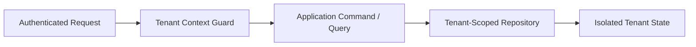

# Clean Architecture Multi-Tenant Core (.NET 9)


**Stack:** `C# 12 · .NET 9 · Clean Architecture · Multi-Tenant Domain Model`

## Overview
A zero-dependency domain and application core enforcing strict multi-tenant data isolation, deterministic tenant context validation, and invariant-checked repository operations.

## Architecture & Execution Flow


## Key Engineering Capabilities
- **Strict Tenant Context Guardrails:** Rejects cross-tenant reads and writes at the domain boundary before persistence execution.
- **Invariant-First Entity Design:** Encapsulates state transitions and validation inside domain aggregates.
- **Deterministic Audit Metadata:** Tracks tenant-scoped creation and modification provenance across operations.
- **Executable Verification Suite:** Self-contained `.NET 9` verification runner executed automatically via GitHub Actions CI.

## Local Verification
Run the self-contained verification suite locally:

```bash
dotnet run
```

## Documentation
- [Architectural Decisions](docs/DECISIONS.md)
- [Security & Isolation Model](docs/SECURITY.md)
